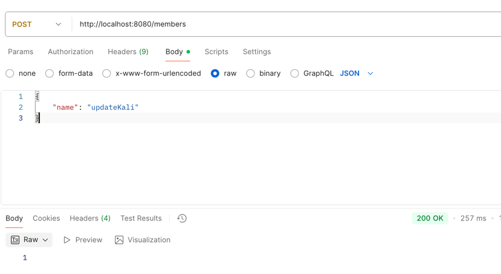
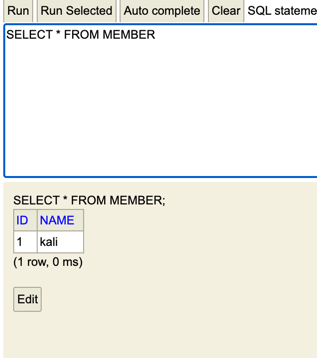

## 주제
리졸버를 거쳐 반환된 엔티티는 영속성 컨텍스트에서 더티 체킹이 불가능한 상태로 서비스 계층에 넘어오는가?
(OSIV가 켜져 있다 가정한다면)

### 실험 방식
1. resolver에서 `Member` 엔티티를 그대로 반환한다.
2. modify 메서드의 적용 유무(명시적 save 호출 X)로 가설 결론 파악 가능
    2.1) 적용됨 -> 더티 체킹 가능
    2.2) 적용되지 않음 -> 더티 체킹 불가능

### 실험 결과
`2.1)` 임으로 더티 체킹이 가능하다

### + 추가 실험
가설: OSIV를 끄면 더티 체킹이 되지 않을까?
실험 방식: application.yml에 OSIV 끄는 설정 추가
- `spring:jpa:open-in-view: false`

결과: 로직은 돌아가나 변하지 않음

### 알게 된 사실

### 개념

출처
